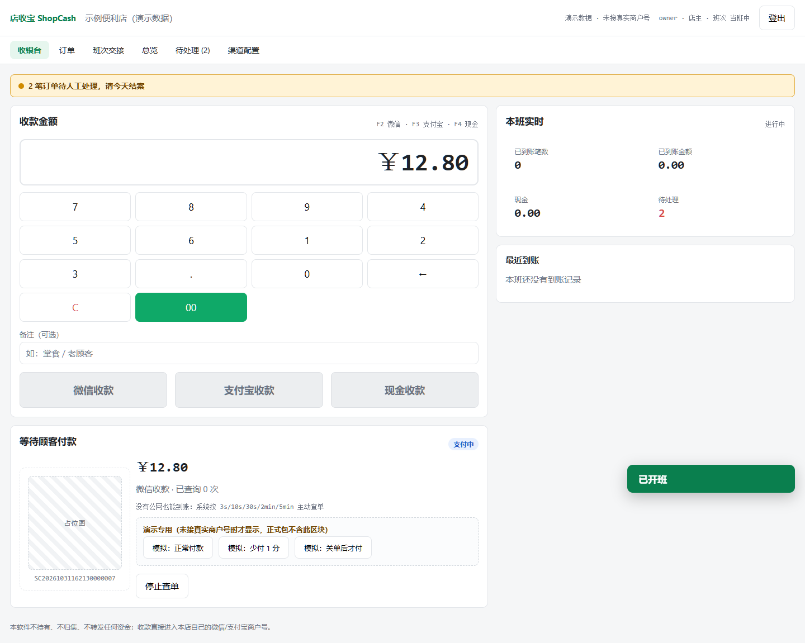
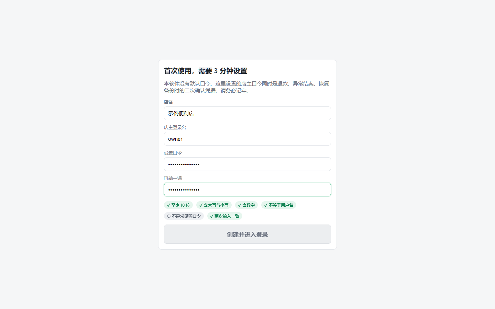
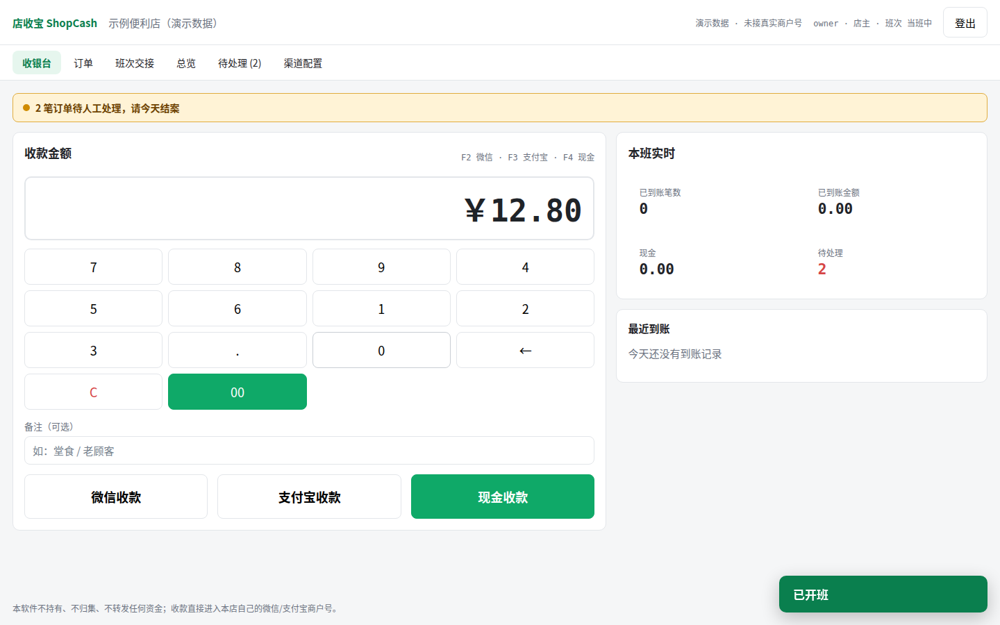
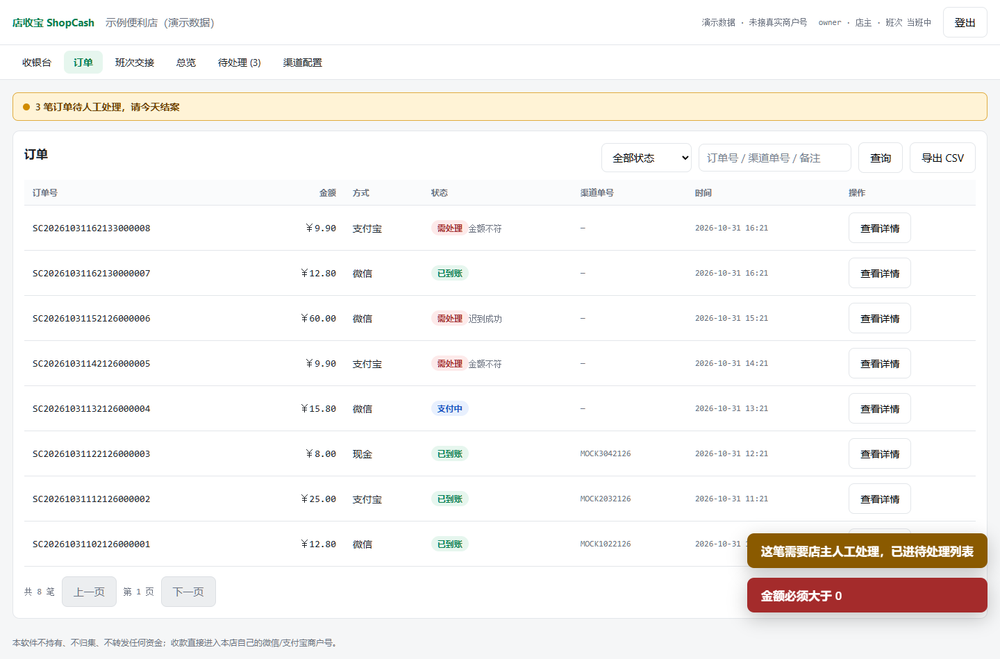
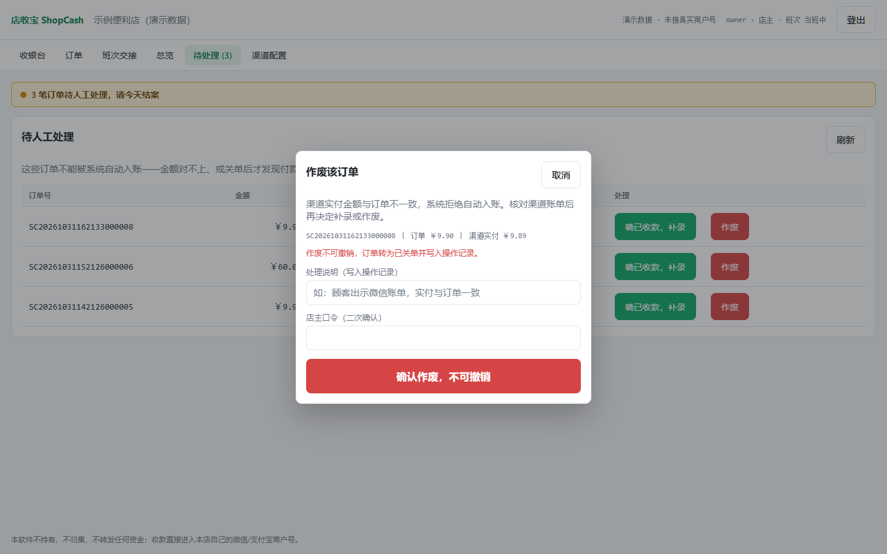
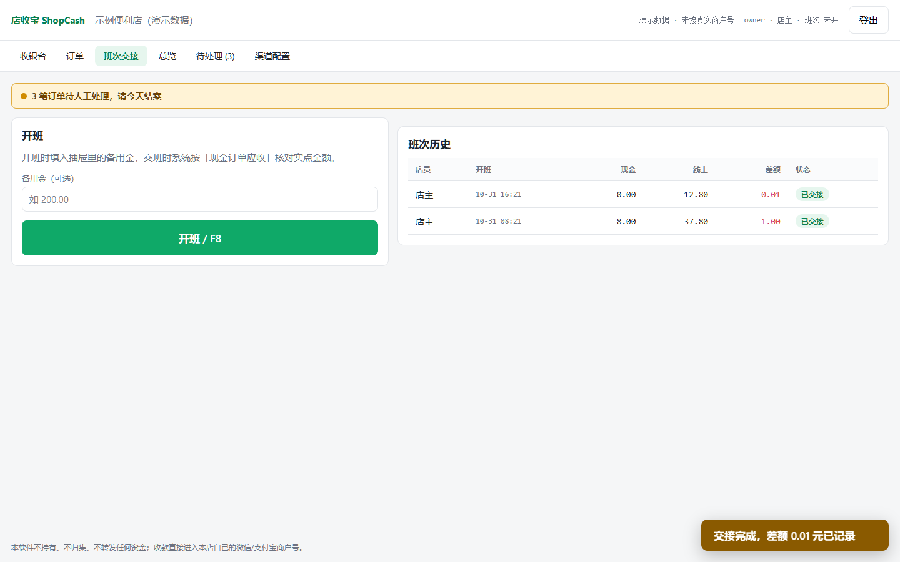
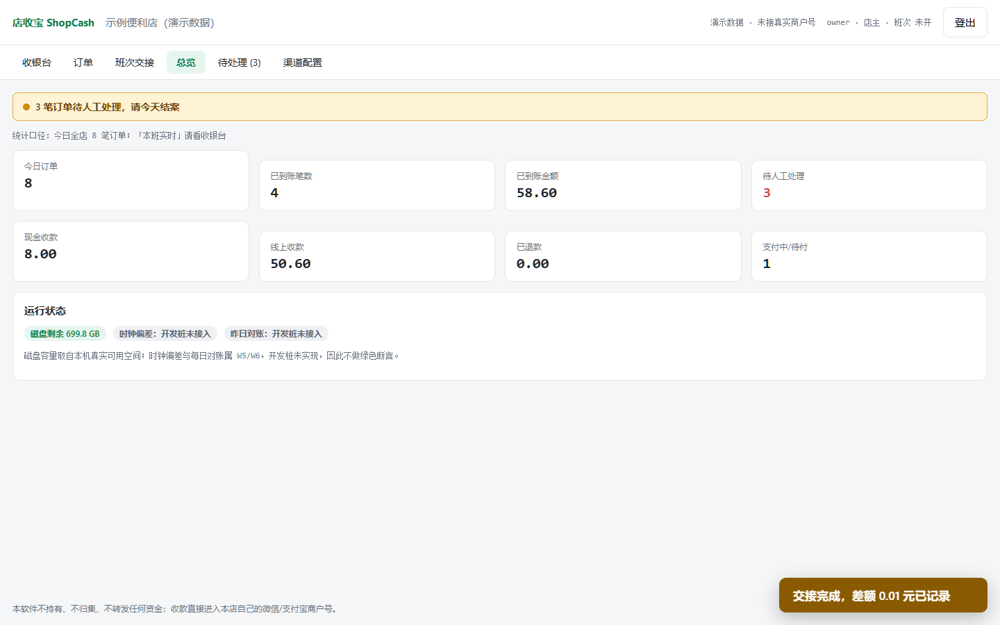
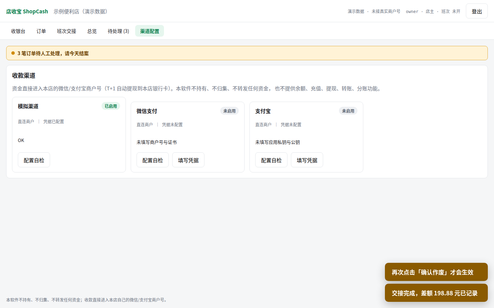

# 店收宝 ShopCash

**单机门店收银与收款记账软件**：一个 Windows 便携目录，双击即用，数据全部落在本机 SQLite。
收款直接进入**本店自己申请的微信/支付宝商户号**，T+1 由渠道自动提现到本店银行卡——
**本软件不持有、不归集、不转发任何资金**。

`NestJS 11` · `TypeScript` · `Prisma 6 + SQLite(WAL)` · `Vue 3.5` · `Tauri 2` · `Node 22 LTS`

[](https://github.com/badhope/shopcash/actions/workflows/ci.yml)


> 中文 · [English below](#english-overview)

<p align="center">
  
</p>

## 为什么是"单机版"

本项目源自对开源仓库 KeBaiPay（原址 `gitcode.com/badhope/KeBaiPay`，2026-10-31 核查该地址已 404，溯源以本文档与 PRD 1.1 为准）的安全与合规审查。那次审查发现一个结构性问题：
它宣称"资金绝不过平台"，但数据模型是**平台级单一商户号 + 无子商户进件 + 无结算实现路径**——真拿去给多个商家收款，
正好落在央行定义的"二清"上（以平台对接或"大商户"模式接入持证机构，留存商户结算资金并自行开展商户资金清算）。

店收宝把这条线彻底划清：**一家店、一个商户号、一份本地账本**。软件只做订单信息流和记账，资金链路由商家与持牌渠道直接完成。

## 界面实拍

以下截图由 Playwright 驱动 Chromium **实跑主流程**产生（`npm run test:ui`，CI 每次构建都会跑并把截图归档成制品），不是设计稿、不是摆拍。
20 张截图覆盖：首启向导空态与弱口令拦截、小键盘录入、收款码等待、到账翻转、金额不符、0 元拒绝、订单簿与状态时间线、异常结案二次确认、班次交接、总览、渠道自检、店员权限边界。

| 首启向导（弱口令被拦） | 收银台·金额录入 | 等待顾客付款 | 订单簿 |
|---|---|---|---|
|  |  |  |  |

| 待人工处理（作废需二次确认） | 班次交接 | 总览 | 渠道配置 |
|---|---|---|---|
|  |  |  |  |

## 功能现状

**已实现并通过自动化验证**

- 首启向导：无默认口令，`checkPassword()` 统一校验长度 / 大小写 / 数字 / 非用户名 / 弱口令表（`ChangeAdmin2026`、`Admin@2026` 等 10 条，含子串变体）
- 收银台：小键盘录入、`F2` 微信 / `F3` 支付宝 / `F4` 现金、到账状态实时翻转与提示音、待付款时禁止重复下单、可停止查单
- 订单状态机 `PENDING → PAYING → PAID → REFUNDING → REFUNDED`，另有 `CLOSED` 与 `EXCEPTION`
- 主动查单退避：3s/10s/30s/2min/5min，之后每 5min 一次，到 `orderExpireMinutes`（默认 15 分钟）关单
- 订单簿与状态时间线（UTC 存储、按 +08:00 展示）、CSV 导出（UTF-8 BOM、引号转义、公式前缀防护）
- 班次与交接班：备用金、本班应收现金/线上（实时计算）、实点现金、差额与交接说明；登出重登自动恢复当班班次
- 员工分账号与权限分级（店主 / 店员），订单、总览、异常、渠道的数据范围过滤全在服务端
- 待人工处理工作台：金额不符、迟到成功等异常必须店主输入口令二次确认后才可补录 / 作废
- 渠道配置中心：mock / 微信 / 支付宝三套凭据表单 + 配置自检 + 店主口令二次确认 + 只回显掩码
- 开发期一键接口自检（24 项断言）与界面实跑（20 步、零控制台报错）

**仅开发桩、尚未落地真实后端**：NestJS sidecar、Prisma/SQLite 迁移、Tauri 壳、真实微信/支付宝渠道、退款、
审计哈希链、备份恢复、诊断信息包、每日对账。开发期数据在内存里，进程重启即回到演示数据。

**尚未实现（V2 路线）**：商品库与扫码枪、小票打印、多门店集中管理、对外开放 API、AI 查账助手、服务商进件与分账。

## 三条不能绕过的资金硬规则

写在 `packages/shared/src/order-state.ts`，纯函数、可穷举测试，前后端与 mock 复用同一份实现：

1. **金额强校验**：渠道实付金额必须与订单金额完全相等才允许置 `PAID`；不等或渠道未返回金额 → `EXCEPTION(AMOUNT_MISMATCH)`
2. **迟到的成功只进人工**：已 `CLOSED` 的订单事后查到支付成功 → `EXCEPTION(LATE_SUCCESS)`，绝不自动入账
3. **条件原子更新**：所有状态推进必须 `UPDATE ... WHERE id = ? AND status IN (...)`，0 行即并发冲突

金额口径同样锁死：全链路以「分」为整数存储，元只在出入参与界面出现；超过两位小数**直接拒绝**，不做四舍五入。

## 快速开始

```bash
npm ci            # prepare 钩子会自动编译 packages/shared 产出 ESM，无需手动 build
npm run verify    # = lint + 模板绑定自检 + 单测 + 前端构建
npm run dev       # 本机界面 + 开发期 mock API：http://127.0.0.1:5199
```

自检命令（改资金逻辑必须以下全绿才算完成）：

```bash
npm run test:cov      # 内核单测 + 覆盖率门槛 90%
npm run test:api      # 24 项资金/权限/会话硬规则端到端检查
npm run test:ui       # 20 步界面实跑 + 逐页截图 + 控制台错误采集
npm run lint          # tsc --noEmit（覆盖 packages/**/*.ts）
npm run check:vue     # .vue 模板绑定自检（tsc 不覆盖 .vue，漏 import 会静默空态）
```

演示口令（仅开发期 mock 服务，生产不存在默认口令）：店主 `owner / Shop2026test`，店员 `staff / Staff2026test`。

## 目录结构

```
packages/shared/   金额换算 + 订单状态机 + 口令策略 + 时间格式化 + CSV + 查单退避（唯一真相源，编译出 ESM 给前端与 mock 复用）
web/               Vue 3 收银界面
tools/             mock-server.js —— 仅开发期使用的接口桩
scripts/           ui-check.mjs（界面实跑）、api-rules-check.mjs（规则端到端）、vue-bindings-check.mjs（模板绑定）、push-remotes.sh
docs/              店收宝-PRD-v1.md、设计定稿、api-schema.md（当前开发桩接口）、screenshots/
```

## 架构要点

- **当前可运行形态**：Vite 开发服务器把 `tools/mock-server.js` 挂成 `/api` 中间件，界面与接口同源，数据在内存
- **生产目标形态（未实现）**：Tauri(Rust) 壳 → NestJS sidecar（仅听 127.0.0.1）→ Prisma + SQLite(WAL)
- **只绑 `127.0.0.1`**，无公网监听端口，无 Redis、无 Docker、无云服务器
- **并发控制设计**：进程内 Mutex（订单号粒度）→ SQLite 事务 → 条件原子更新 → 唯一约束幂等
- **金额口径**：全链路整数分；元↔分只走 `yuanToFen()` / `fenToYuan()`，超出两位小数直接拒绝
- **凭据处理**：界面只回显掩码；真实 AES-256-GCM 落库随真实后端交付

## English Overview

ShopCash is a **single-store, self-hosted POS and payment ledger** for Windows. Money goes straight into the
merchant's own WeChat Pay / Alipay direct merchant account; the software never holds, aggregates, or settles funds.
It was redesigned after a security review of KeBaiPay, whose data model (one platform-level merchant number, no
sub-merchant onboarding, no settlement path) would have amounted to unlicensed second-clearing if operated for
multiple merchants. Built with NestJS 11 + Prisma 6 + SQLite (WAL) inside a Tauri shell, with a money-as-integer-fen
policy, a hard payment state machine, and three-layer reconciliation (callback → active query polling → daily bill).

## 开发与交付约束

所有开发规范见 [`docs/店收宝-PRD-v1.md`](docs/店收宝-PRD-v1.md)（唯一真相源），AI 编程工具的红线见 [`CLAUDE.md`](CLAUDE.md)。

## 合规声明

本软件为门店自用收银与记账工具，不持有、不归集、不转发任何资金，不为任何第三方完成资金结算，不提供余额 / 充值 /
提现 / 转账 / 分账功能，也不代商户设置或修改结算账户。若需开展多商家集中收款，应先行取得微信 / 支付宝**服务商资质**，
通过特约商户进件（`sub_mchid`）与官方分账能力处理资金；开展收单外包服务（含聚合支付技术服务）前须按中国支付清算协会
要求完成备案（"先备案后展业"）。详见 PRD 第 17 章与第 28.5 章。

## 许可

MIT

---

内容由 AI 生成
